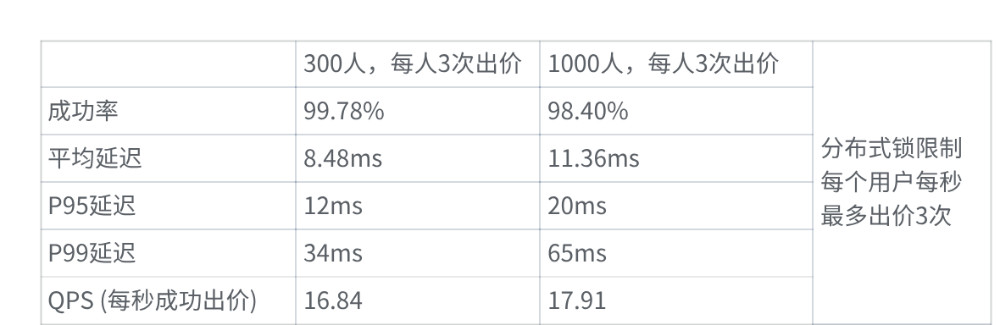

# 实时竞拍大师 — 直播电商竞拍全栈系统

[作品集](https://bill02chen.github.io/chenyanrui-site/) · [GitHub](https://github.com/Bill02Chen)

面向直播竞拍的高并发全栈系统：React + TypeScript 前端，Node.js + Socket.IO
后端，Redis 承担出价主链路，MySQL 负责持久化。项目为 2026 字节跳动 AI 全栈
挑战赛个人参赛作品，本仓库是赛后审计后的最终版本。

**关键结果：** 单直播间 1,000 用户、每人 3 次出价，同毫秒突发场景从
1/3000（0.03%）提升到 **3000/3000（100%）**，客户端平均延迟 199.59 ms；
节流场景 3000/3000 成功，平均延迟 9.32 ms、P99 49 ms。下行广播从 3,018,000
条降到 7,000 条，约 431 倍。

> 上述数字是本机压测结果，不是生产 SLA。压测脚本、环境指纹和原始日志都在
> [`perf-run/`](perf-run/)；每轮数字都能追溯到对应日志。

## 问题

直播竞拍的核心矛盾是「毫秒级同步」与「数据不能丢」：

1. 每次出价同步写 MySQL，延迟随并发上升，无法支撑单直播间 1,000+ 连接。
2. Redis 宕机或重启会丢失当前竞拍状态，出价、排行榜和倒计时全部中断。
3. 同一毫秒的并发出价会超卖，或者出现后到出价覆盖先到出价。
4. 多个直播间同时运行时，消息必须按房间隔离，不能串播。
5. 主播后台需要实时看到价格、倒计时和 Top 排名。

## 做法

### 出价：默认原子 Lua，锁引擎保留作对照

- 出价全程在 Redis 内完成，不同步写 MySQL；
- 默认走单个 **Lua 脚本**（[bidScript.js](backend/src/utils/bidScript.js)）：
  一次 EVAL 内完成「校验价格 → 校验用户 → 扣减/写入 → 更新 ZSet」；
- `BID_ENGINE=lock` 可切回原来的分布式锁实现
  （[distributedLock.js](backend/src/utils/distributedLock.js)），用于对比；
- 用户级限流，防止单用户刷价；
- 出价进入待落盘队列，**每 5 秒批量写入 MySQL**。

### 状态恢复与自愈

- 三个心跳任务：1 秒状态自愈、10 秒数据同步、5 秒定时落盘；
- Redis 状态丢失后，从 MySQL 重建竞拍状态并回放排行榜；恢复演练见
  [`perf-run/verify-ranking-recovery.sh`](perf-run/verify-ranking-recovery.sh)；
- 进程重启后自动恢复活跃竞拍，不依赖人工干预。

### 广播收敛

- Socket.IO 按直播间分房间；
- 同毫秒突发时，多个成功出价会合并为更少的广播事件；
- 「只回出价者」模式把广播收件人从房间全员降到实际出价者，避免 3000 次成功
  × 1000 人的消息放大。

### 可观测性

- 后端提供 `/api/metrics`：出价成功率、延迟分位、锁重试、广播条数、事件循环
  延迟、RSS 等；
- 压测脚本每轮先写环境指纹，再跑负载，最后抓一次服务端指标。

```text
React + TS ──HTTP/WebSocket── Node.js + Socket.IO
                                  │
                    ┌─────────────┴─────────────┐
                    ▼                           ▼
              Redis 8.6                     MySQL 8.3
        Lua 原子出价 / ZSet 排行        竞拍、出价、订单
        限流 / 待落盘队列 / 在线集合     批量落盘 + 状态重建
```

## 关键结果

原始挑战赛报告与赛后审计分开列。原始 98.40% 的 1.6% 失败在补测中**没有复现**：
两轮 1,000 人测试分别为 99.70% 与 99.96%（实连 900 / 905，总出价 2700 / 2715）。
这里同时保留原始值和补测值。

| 场景 | 成功 | 平均延迟 | P99 | 来源 |
| --- | --- | ---: | ---: | --- |
| 原始报告，1,000 人 × 3 次，节流 50 ms | 98.40% | 11.36 ms | 65 ms | 原始挑战赛报告 |
| 补测，1,000 人 × 3 次，节流 50 ms | 99.70% / 99.96% | 9.31 / 8.68 ms | 44 / 22 ms | `20261011-000226` / `20261011-000639` |
| 赛后 Lua + 合并广播，1,000 人 × 3 次，节流 50 ms | 3000/3000 | **9.32 ms** | **49 ms** | `20261011-005757-paced-lua-final-1000u-x3.log` |
| 赛后 Lua + 合并广播 + 只回出价者，同毫秒突发 | **3000/3000（100%）** | **199.59 ms** | **222 ms** | `20261011-005706-burst-lua-bidder-1000u-x3.log` |
| 原始分布式锁，同毫秒突发（日志轮次） | 0/3000（0.00%） | — | — | `20261011-002220-burst-1000u-x3-pace0.log` |
| 下行广播消息 | 3,018,000 → 7,000 | — | — | 中间轮与最终轮 `/api/metrics` |



原始报告截图（300 人 / 1000 人对照）。

补充：

- 同毫秒突发 3000 笔后，Redis 价格严格递增，MySQL 落盘 3000 条，最高价一致；
- 审计记录中原始锁引擎另有一轮 1/3000（0.03%）；无论 0 还是 1，锁引擎在
  3000 笔同毫秒请求下都只剩个位数成功。
- 广播收敛来自「合并事件 + 只回出价者」两步，单做 Lua 会把压力转移到广播：
  中间轮 3000 次成功产生 3,018,000 条消息，客户端可见成功率只有 52.13%；
- Redis 状态丢失恢复目标是 1 个心跳（约 1 秒），演练脚本和日志在
  `perf-run/verify-ranking-recovery.sh`、`perf-run/server-outage.log`。

## 证据

**代码**

- 原子出价：[backend/src/utils/bidScript.js](backend/src/utils/bidScript.js)
- 出价服务：[backend/src/services/auctionService.js](backend/src/services/auctionService.js)
- Redis 操作：[backend/src/services/redisService.js](backend/src/services/redisService.js)
- 锁引擎（对照）：[backend/src/utils/distributedLock.js](backend/src/utils/distributedLock.js)
- WebSocket 与心跳：[backend/src/socketServer.js](backend/src/socketServer.js)
- 指标：[backend/src/utils/metrics.js](backend/src/utils/metrics.js)
- 前端直播间：[frontend/src/pages/LiveRoom.tsx](frontend/src/pages/LiveRoom.tsx)

**压测**

- 运行器：[perf-run/run-loadtest.sh](perf-run/run-loadtest.sh)
- 环境指纹：[perf-run/env-fingerprint.sh](perf-run/env-fingerprint.sh)
- 负载客户端：[backend/test-high-concurrency.js](backend/test-high-concurrency.js)
- 竞拍初始化：[backend/setup-test-auction.js](backend/setup-test-auction.js)
- 最终日志：[perf-run/logs/](perf-run/logs/)
- 说明：[perf-run/README.md](perf-run/README.md)

**文档**

- 运行模式：[docs/RUN_MODES.md](docs/RUN_MODES.md)
- 架构：[TECHNICAL_ARCHITECTURE.md](TECHNICAL_ARCHITECTURE.md)
  （描述最初的挑战赛架构；最终版本默认 Lua，锁引擎保留为对照）

## 快速开始

需要 Node.js 18+、Docker 与 Docker Compose。

```sh
# 1. 启动 MySQL 8.3（宿主 3307）和 Redis 8.6（宿主 6380）
MYSQL_ROOT_PASSWORD=your-password docker-compose up -d

# 2. 配置后端
cd backend
cp .env.example .env
# 编辑 .env：
#   MYSQL_PASSWORD=your-password
#   REDIS_URL=redis://127.0.0.1:6380   # 用 compose 的 Redis
#   或 redis://127.0.0.1:6379          # 用宿主机 Redis
npm install
node src/production-demo.js

# 3. 启动前端（新终端）
cd frontend
npm install
npm run dev
```

- 用户端：<http://localhost:5173>
- 管理后台：<http://localhost:5173/admin>
- 健康检查：<http://localhost:3002/api/health>
- 指标：<http://localhost:3002/api/metrics>

管理员账号的代码默认值是 `admin` / `admin123`，可由 `ADMIN_USERNAME`、
`ADMIN_PASSWORD` 和 `ADMIN_PASSWORD_SALT` 覆盖。部署到公网前必须修改。

## 复现压测

```sh
# MySQL 容器已在运行；脚本用 MYSQL_PASSWORD 登录容器
export MYSQL_PASSWORD=your-password

# 节流场景：1000 人 × 3 次，50 ms 间隔
bash perf-run/run-loadtest.sh paced 1000 3 50

# 同毫秒突发
bash perf-run/run-loadtest.sh burst 1000 3 0
```

脚本会写入 `perf-run/logs/<时间戳>-<场景>-1000u-x3.log`，包含环境指纹、
压测前后 `/api/metrics` 和完整延迟分位。Redis 连接地址、MySQL 端口等以
`.env` 和 `env-fingerprint.sh` 为准；换机器后先跑一次环境指纹再比较数字。

## 配置

关键环境变量见 [`backend/.env.example`](backend/.env.example)：

| 变量 | 示例 | 说明 |
| --- | --- | --- |
| `PORT` | 3002 | 后端 HTTP 端口 |
| `REDIS_URL` | `redis://127.0.0.1:6380` | compose Redis；宿主机 Redis 用 6379 |
| `MYSQL_HOST` / `MYSQL_PORT` | localhost / 3307 | MySQL 地址 |
| `MYSQL_PASSWORD` | `your-password` | 与 compose 的 root 密码一致 |
| `MYSQL_DATABASE` | `auction_master` | 数据库名 |
| `BID_ENGINE` | `lua` / `lock` | 出价引擎，默认 `lua` |
| `ADMIN_USERNAME` / `ADMIN_PASSWORD` | `admin` / `admin123` | 演示账号，部署前修改 |

## 目录

```text
backend/
  src/
    config/             MySQL、Redis 连接
    services/           auctionService、redisService
    utils/              bidScript（Lua）、distributedLock、metrics、logger
    index.js            生产入口
    production-demo.js  演示入口
  init.sql              表结构
  test-high-concurrency.js
frontend/
  src/pages/            用户直播间、订单、管理后台
perf-run/               压测脚本、环境指纹、原始日志
docs/RUN_MODES.md       宿主机 / 全 Docker 两种运行模式
docker-compose.yml      MySQL 8.3 + Redis 8.6
TECHNICAL_ARCHITECTURE.md
```

## 已知限制

- 单机部署；没有做多实例下的分布式协调和 Redis 集群方案。
- 压测是客户端侧延迟，受本机 CPU、网络和 Node 客户端影响；换机器不能直接对比。
- 原始 98.40% 与补测 99.70% / 99.96% 的差异没有完全归因；原始报告的失败样本
  是「获取分布式锁失败」，补测未复现 1.6% 的失败率。
- 演示账号和默认盐值公开，只适合本地演示。
- 前端 API 地址写死为 `http://localhost:3002`，部署前需改成实际地址。
